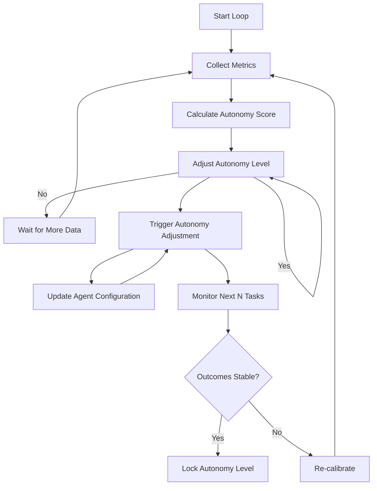

<!-- Markdown version for AI agents and readers. Canonical: https://pratikdhanave.com/blog/posts/agentic-software-engineering-autonomy.html -->

# Agentic Software Engineering in Go: Autonomy Calibration

*Calibrating agent freedom with the AEMM maturity model and Elastic Loop framework*

---

## The Problem: Fixed Autonomy Levels

Most agentic systems use a **fixed autonomy model**:

- **Level 0**: Developer writes all code (no agent involvement)
- **Level 1**: Agent suggests completions, developer approves
- **Level 2**: Agent generates functions, developer reviews
- **Level 3**: Agent implements features, developer validates
- **Level 4**: Agent owns features end-to-end, human on exception

**The problem**: Fixed levels ignore critical variables:

| Variable | Why It Matters |
|----------|----------------|
| **Task Risk** | High-risk tasks (financial, healthcare) need more oversight |
| **Context Quality** | Poor context → less autonomy needed |
| **Agent Confidence** | Low-confidence outputs need more review |
| **Historical Success** | Teams with good track records can have higher autonomy |
| **Domain Criticality** | Core business logic needs more oversight than utility code |

**The result**: Either too much autonomy (risking errors in critical systems) or too little (stifling productivity in low-risk areas).

## The Solution: AEMM Maturity Model

**AEMM** (Autonomous Engineering Maturity Model) dynamically adjusts autonomy based on measurable factors, not fixed levels.

### The Four AEMM Dimensions

| Dimension | Scale | What It Measures |
|-----------|-------|------------------|
| **Risk Score** | 0-100 | Task criticality, data sensitivity, business impact |
| **Context Quality** | 0-100 | ADR coverage, spec completeness, code pattern maturity |
| **Agent Confidence** | 0-100 | Model confidence scores, historical accuracy |
| **History Success Rate** | 0-100 | Team's past verification success rate |

### The Elastic Loop Formula

```
Autonomy Score = (Context Quality + Agent Confidence + History Success Rate - Risk Score) / 3
```

```
Autonomy Level = f(Autonomy Score)
```

```
Autonomy Level Mapping:
  80-100: Level 4 (Autonomous - with monitoring)
  60-79:  Level 3 (Managed - validation required)
  40-59:  Level 2 (Supervised - review required)
  20-39:  Level 1 (Assisted - approval required)
  0-19:   Level 0 (Manual - developer writes all code)
```

### Risk Scoring Matrix

| Risk Factor | Score Contribution | Example |
|-------------|-------------------|---------|
| Financial data | +30 | Payment processing, personal data |
| Healthcare data | +40 | HIPAA-regulated, patient records |
| Core business logic | +20 | Core revenue features |
| Utility code | +5 | Logging, metrics, reporting |
| External API integration | +15 | Third-party services |
| New technology | +25 | Unproven Go version, new library |
| Critical security surface | +35 | Authentication, authorization |
| Simple CRUD operations | +5 | Create/Read/Update/Delete |

### Context Quality Scoring

| Factor | Score Contribution | Example |
|--------|-------------------|---------|
| ADRs present | +25 | Full ADR set documented |
| Specifications complete | +20 | Full spec with all fields |
| Code patterns mature | +15 | Established Go idioms |
| Tests existing | +15 | Verification suite in place |
| Documentation complete | +10 | All docs written |
| No critical gaps | +15 | No missing information |

### Agent Confidence Scoring

| Source | Score Contribution | Example |
|--------|-------------------|---------|
| Model confidence | +20 | Model's internal probability |
| Historical accuracy | +25 | Team's past success rate |
| Test coverage | +20 | Verification suite coverage |
| Lint compliance | +15 | Code passes all lint checks |
| Specification compliance | +20 | Code follows all specs |

### History Success Rate

```
History Success Rate = (Successful Deployments / Total Deployments) × 100

Example: 27/30 deployments successful = 90% success rate
```

### Autonomy Calibration in Practice

```go
// pkg/autonomy/calibration.go — Dynamic autonomy calculation
func CalculateAutonomy(risk, contextQuality, confidence, history float64) (score float64, level string) {
    // Calculate autonomy score
    score = (contextQuality + confidence + history - risk) / 3
    
    // Clamp to valid range
    if score < 0 {
        score = 0
    }
    if score > 100 {
        score = 100
    }
    
    // Determine autonomy level
    switch {
    case score >= 80:
        level = "Level 4: Autonomous (with monitoring)"
    case score >= 60:
        level = "Level 3: Managed (validation required)"
    case score >= 40:
        level = "Level 2: Supervised (review required)"
    case score >= 20:
        level = "Level 1: Assisted (approval required)"
    default:
        level = "Level 0: Manual (developer writes all code)"
    }
    
    return score, level
}
```

### Dynamic Autonomy Adjustment

```go
// pkg/autonomy/elastic_loop.go — Elastic Loop framework
type ElasticLoop struct {
    riskScore          float64
    contextQuality     float64
    agentConfidence    float64
    historySuccess     float64
    autonomyLevel      string
    lastCalculated     time.Time
    calibrationInterval time.Duration
}

// Recalibrate autonomy based on current metrics
func (el *ElasticLoop) Recalibrate(risk, contextQuality, confidence, history float64) {
    el.riskScore = risk
    el.contextQuality = contextQuality
    el.agentConfidence = confidence
    el.historySuccess = history
    
    score, level := CalculateAutonomy(risk, contextQuality, confidence, history)
    el.autonomyLevel = level
    el.lastCalculated = time.Now()
    
    // Log calibration
    logAutonomyCalibration(el)
    
    // Trigger autonomy adjustment
    el.adjustAutonomy()
}

// Adjust autonomy based on new level
func (el *ElasticLoop) adjustAutonomy() {
    switch el.autonomyLevel {
    case "Level 4: Autonomous (with monitoring)":
        el.enableFullAgentAutonomy()
    case "Level 3: Managed (validation required)":
        el.enableManagedAutonomy()
    case "Level 2: Supervised (review required)":
        el.enableSupervisedAutonomy()
    case "Level 1: Assisted (approval required)":
        el.enableAssistedAutonomy()
    case "Level 0: Manual (developer writes all code)":
        el.disableAgentAutonomy()
    }
}
```

### Autonomy Calibration Workflow



### Autonomy Calibration in the Factory

```go
// factory/autonomy.go — Factory integration
func (fo *FactoryOrchestrator) CalculateTaskAutonomy(task *Task) string {
    // Gather metrics for this task
    risk := fo.calculateTaskRisk(task)
    contextQuality := fo.calculateContextQuality(task.SpecID)
    confidence := fo.calculateAgentConfidence(task)
    history := fo.getTeamHistorySuccessRate()
    
    score, level := CalculateAutonomy(risk, contextQuality, confidence, history)
    
    // Store autonomy metadata in task
    task.AutonomyLevel = level
    task.AutonomyScore = score
    
    // Persist autonomy metadata
    _ = fo.persistence.SaveTask(ctx, &persistence.TaskRecord{
        ID:        task.ID,
        Type:      task.Type,
        SpecID:    task.SpecID,
        Priority:  task.Priority,
        Status:    task.Status,
        AssignedTo: task.AssignedTo,
        CreatedAt: task.CreatedAt,
        Retries:   task.Retries,
    })
    
    return level
}
```

### Autonomy Gates

The harness includes autonomy gates that prevent code generation beyond the calibrated level:

```go
// autonomy/gates.go — Autonomy gates
func CheckAutonomyGate(task *Task, autonomyLevel string) bool {
    // Current agent's maximum allowed level
    maxAllowed := fo.GetMaxAutonomyLevel()
    
    // Parse the requested level
    requestedLevel := ParseAutonomyLevel(autonomyLevel)
    
    // Check if requested level exceeds maximum allowed
    return requestedLevel <= maxAllowed
}
```

### Autonomy Calibration Dashboard

| Metric | Current | Target | Action |
|--------|---------|--------|--------|
| Average Autonomy Level | Level 2 (Supervised) | Level 3 (Managed) | Increase context quality |
| Context Quality Score | 65/100 | 80/100 | Add more ADRs and specs |
| Agent Confidence Score | 70/100 | 85/100 | Improve model selection |
| History Success Rate | 80% | 95% | Improve verification practices |
| Risk Distribution | See chart | N/A | Review high-risk tasks |

### Why Autonomy Calibration Matters

| Concern | Fixed Autonomy | Dynamic AEMM |
|---------|---------------|----------------|
| **Risk Management** | Fixed, regardless of task | Adaptive based on risk score |
| **Productivity** | Too restrictive for low-risk tasks | Optimized per-task |
| **Quality** | Inconsistent enforcement | Consistent via metrics |
| **Team Growth** | Stagnates at current level | Gradual progression possible |
| **Security** | Over-cautious or reckless | Balanced based on data |
| **Team Scaling** | Hard to scale managers | System scales automatically |

### Quick Start

```bash
# Initialize project with autonomy support
asf init

# The factory will automatically:
# 1. Calculate autonomy for each task
# 2. Apply autonomy gates during harness execution
# 3. Adjust based on success/failure feedback
# 4. Provide calibration dashboard

# Monitor autonomy metrics
asf factory status

# Adjust autonomy settings
# Configure in specs/autonomy.yaml or via MCP API
```

### Next: Security & Safety

In the next post, we'll explore **Security & Safety** — prompt injection defense, sandbox execution, RBAC, and other production-grade safety mechanisms. We'll introduce `pkg/security` and demonstrate how to protect the factory from common agentic attack vectors.

---

*All code examples are in Go 1.23+. Diagrams use white-background Archify for presentation-ready architecture visualizations.*

---

Author: Pratik Dhanave (https://pratikdhanave.com) | Published: 2026-11-07
Canonical: https://pratikdhanave.com/blog/posts/agentic-software-engineering-autonomy.html
Attribution: please link the canonical URL when citing or quoting this post.
