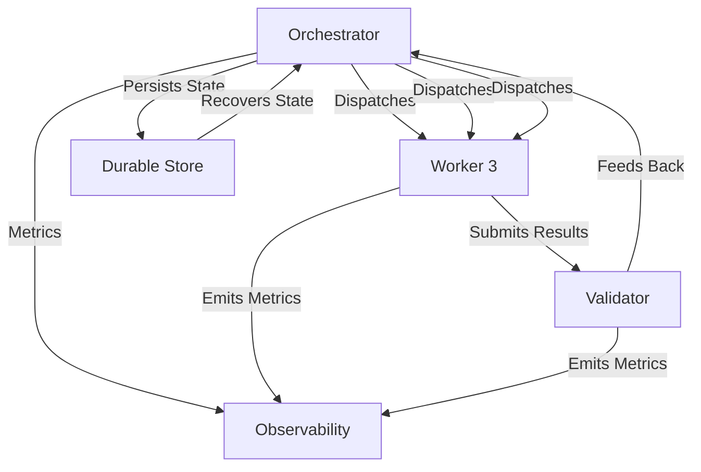

<!-- Markdown version for AI agents and readers. Canonical: https://pratikdhanave.com/blog/posts/agentic-software-engineering-factory.html -->

# Agentic Software Engineering in Go: Software Factory Orchestration

*Designing always-on, self-sustaining Orchestrator-Worker-Validator systems*

---

## The Problem: Ad-Hoc Agent Orchestration

Most agentic setups are **ad-hoc orchestration**:

- Agents are launched manually
- No persistent state between runs
- No auto-scaling based on load
- No built-in resilience or retry logic
- No observability or metrics
- One-off executions, not continuous systems

**The problem**: Without a proper orchestration layer, agentic workflows remain:
- **Fragile**: Break easily when network, agents, or dependencies change
- **Manual**: Require constant human intervention
- **Non-scalable**: Horizontal scaling only, not systematic
- **Unobservable**: No metrics, no debugging, no insight into agent behavior
- **Non-resilient**: Single point of failure, no checkpointing or recovery

## The Software Factory Orchestration

**Software Factory Orchestration** designs continuous, self-sustaining systems based on the **Orchestrator-Worker-Validator** pattern.

### The Factory Triad

| Component | Role | Key Characteristics |
|-----------|------|---------------------|
| **Orchestrator** | Coordinates workflow, manages task queue, handles scaling | Stateful, durable, auto-scaling, persists state |
| **Worker** | Executes assigned tasks (generate, verify, review, refactor) | Stateless, scalable, configurable autonomy, reports results |
| **Validator** | Runs verification loops, enforces constraints, provides feedback | Autonomous, configurable, metrics-driven, feedback-generating |



### The Orchestrator

The Orchestrator is the **brain** of the factory. It:

- Manages a task queue of pending, running, and completed tasks
- Auto-scales worker pool based on queue depth and worker utilization
- Persists task state to durable storage (SQLite) for recovery
- Implements retry logic with configurable maximum retries
- Implements rebalancing when workers become imbalanced
- Provides status and metrics endpoints

```go
// pkg/factory/factory.go — Factory Orchestrator
fo := factory.NewFactoryOrchestrator(workingDir, 4)
fo.Start(ctx)

# Submit tasks
fo.SubmitTask(&factory.Task{
    Type:     "generate",
    SpecID:   "spec-001",
    Priority: 1,
})

# Check status
status := fo.GetFactoryStatus()

# Stop gracefully
fo.Stop()
```

### The Worker Pool

Workers are **stateless** units that execute assigned task types:

```go
type Worker struct {
    ID           string
    Role         string
    Capabilities []string
    Status       string // "idle", "busy", "error"
    CurrentTask  *Task
    LastActive   time.Time
}
```

Workers pull tasks from the queue and execute them:

```go
func (fo *FactoryOrchestrator) workerLoop(ctx context.Context, worker *Worker) {
    for {
        select {
        case <-ctx.Done():
            return
        case <-fo.shutdown:
            return
        case task := <-fo.taskQueue:
            fo.executeTask(ctx, worker, task)
        }
    }
}
```

### The Validator

The Validator runs the **AI-TDD verification loop**:

```go
type VerificationResult struct {
    Success         bool
    TestOutput      string
    LintOutput      string
    BuildOutput     string
    Errors          []VerificationError
    Duration        time.Duration
    RetryCount      int
}
```

```go
func (e *VerificationEngine) RunVerification(ctx context.Context, specPath string) (*VerificationResult, error) {
    # Phase 1: Build verification
    # Phase 2: Test verification
    # Phase 3: Lint verification
    # Phase 4: Constraint verification
    # Return result with success/failure and errors
}
```

### Factory Orchestration Lifecycle

```mermaid
flowchart TD
    A[Factory Start] --> B[Initialize Workers]
    B --> C[Begin Task Dispatch]
    C --> D[Task Executed by Worker]
    D -->|Pass| E[Task Marked Complete]
    D -->|Fail| F[Task Retried or Failed]
    F -->|Retries < max| G[Re-queue Task]
    F |>|Retries >= max| G[Task Marked Failed]
    E --> G
    G --> H[Factory Status Updated]
    H --> I[Factory Continues Operation]
    I -->|Shutdown| I[Factory Gracefully Stops]
    I |>|State Persisted| I[State Recovered on Restart]
```

### Task Types

| Task Type | Description | Typical Duration |
|-----------|-------------|-----------------|
| **generate** | Agent generates code from specification | 5-30s |
| **verify** | Verification loop (build, test, lint) | 10-60s |
| **review** | Agent-assisted code review | 5-15s |
| **refactor** | Agent refactors existing code | 10-30s |

### Factory Configuration

```yaml
# specs/factory.yaml — Factory definition (Factories-as-Code)
factory:
  name: "go-agentic-factory"
  version: "1.0"
  max_workers: 8
  default_timeout: "5m"
  retry_policy:
    max_retries: 3
    backoff_base: "2s"
    backoff_max: "30s"
  agents:
    - id: "gen-agent"
      role: "code-generator"
      model: "claude-sonnet-5"
      autonomy: "level_3"
    - id: "verify-agent"
      role: "validator"
      model: "claude-haiku-4-5"
      autonomy: "level_4"
  workflows:
    - id: "code-improvement"
      steps:
        - name: "generate-code"
          agent: "gen-agent"
        - name: "run-verification"
          agent: "verify-agent"
        - name: "review"
          agent: "gen-agent"
```

### Factory Metrics Dashboard

| Metric | Description | Target |
|--------|-------------|--------|
| Workers Total | Total number of workers | Configurable (e.g., 4-8) |
| Workers Busy | Currently executing tasks | ≤ max_workers |
| Workers Idle | Waiting for tasks | ≥ 0 |
| Tasks Pending | Tasks waiting in queue | Varies by load |
| Tasks Completed | Successfully completed tasks | Increasing trend |
| Tasks Failed | Failed tasks (max retries exceeded) | Minimizing |
| Average Task Duration | Mean execution time | Varies by task type |
| Verification Pass Rate | % of verifications that pass | ≥ 95% |
| Auto-Scaling Events | Number of times workers were added/removed | Monitoring only |

### Factory Recovery & Durability

```go
# Persistent task state enables recovery
func (fo *FactoryOrchestrator) restoreTasks() error {
    # Restore pending tasks from SQLite
    # Restore running tasks (mark as pending for retry)
    # Restore completed/failed tasks
    # Restore workers from previous session
    # Resume operation from exact point of failure
}
```

### Factory Integration with MCP

```go
# MCP endpoints for factory control
MCP Endpoints:
- submit_task: Submit a new task to the factory
- get_task_result: Get the result of a submitted task
- get_factory_status: Get current factory status
- list_specs: List all available specifications
- get_spec: Get a specific specification
- list_agents: List all agents in the factory
- run_verification: Run the verification harness
```

### Quick Start

```bash
# Initialize factory
asf init

# Start factory with 4 workers
asf factory start

# Submit tasks
asf factory submit generate spec-001
asf factory submit verify spec-001

# Check status
asf factory status

# Stop factory
asf factory stop

# The factory will automatically:
# 1. Initialize workers
# 2. Process tasks from the queue
# 3. Persist state to SQLite
# 3. Auto-scale based on load
# 4. Recover on restart
# 5. Provide metrics via MCP API
```

### Why Software Factory Orchestration Matters

| Concern | Ad-Hoc Execution | Factory Orchestration |
|---------|-----------------|---------------------|
| **Resilience** | Breaks on error, manual recovery | Auto-recovery from SQLite state |
| **Scalability** | Manual add more workers | Auto-scaling based on queue depth |
| **Observability** | No metrics, blind spots | Full metrics dashboard |
| **Consistency** | Varies by human execution | Consistent, configured behavior |
| **Auditability** | Manual logs, hard to trace | Persistent state, traceable |
| **Onboarding** | Hard to scale beyond 5 developers | Scales to any team size |
| **Cost** | Pay per manual execution | Pay for running infrastructure |

### Why This Series Matters

This 12-part series provides a **complete roadmap** for implementing production-grade Agentic Software Engineering in Go:

| Post | Topic | Key Takeaway |
|------|-------|--------------|
| 1 | Introduction | Overview and foundation patterns |
| 2 | Context Engineering | ADRs and context curation |
| 3 | Specification Engineering | Machine-readable specs, Plan-Build-Verify |
| 5 | AI-TDD Verification | Build, test, lint, constraint validation |
| 5 (duplicate slot) | Autonomy Calibration | AEMM maturity model and Elastic Loop |
| 6 | Security & Safety | Prompt injection defense, sandbox, RBAC |
| 7 | Team Operating Model | Git integration, shared context, PR review |
| 8 | Developer Workflow | Daily loop, spec authoring, prompt patterns |
| 9 | Software Factory Orchestration | Factory as code, durable orchestration |
| 10 | Production Operations | Observability, A/B testing, continuous improvement |
| 11 | Case Study | End-to-end: spec to production |
| 12 | Summary & Future | Complete roadmap and future directions |

---

*All code examples are in Go 1.23+. Diagrams use white-background Archify for presentation-ready architecture visualizations.*

---

Author: Pratik Dhanave (https://pratikdhanave.com) | Published: 2026-11-11
Canonical: https://pratikdhanave.com/blog/posts/agentic-software-engineering-factory.html
Attribution: please link the canonical URL when citing or quoting this post.
