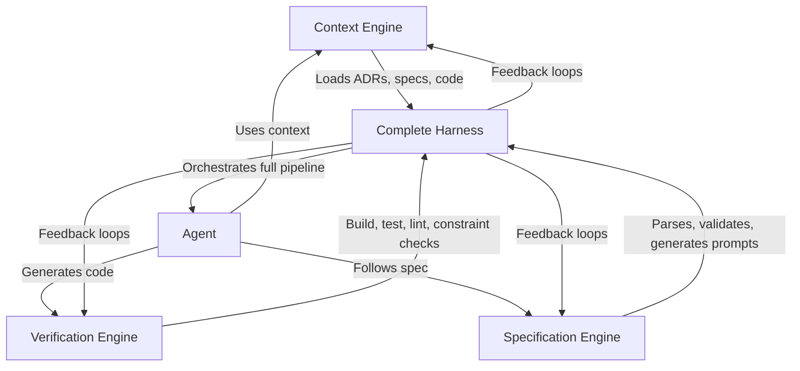

<!-- Markdown version for AI agents and readers. Canonical: https://pratikdhanave.com/blog/posts/agentic-software-engineering-harness.html -->

# Agentic Software Engineering in Go: The Complete Harness

*Integrating context, specifications, and verification loops*

---

## The Problem: Siloed Engineering Disciplines

Until now, we've treated context engineering, specification engineering, and verification loops as separate concerns. But in practice, they are **inextricably linked**:

- **Without context**, specifications are vague and ambiguous
- **Without specifications**, verification has no clear success criteria
- **Without verification**, context engineering has no way to prove its effectiveness
- **Without integration**, each discipline operates in isolation, creating friction and overhead

**The harness** is the integration mechanism that wires all three disciplines into a single self-reinforcing system.

### The Harness Architecture



### The Harness Result

```go
type HarnessResult struct {
    SpecID          string
    Success         bool
    ContextItems    []ContextItem
    SpecPrompt      string
    Verification    *VerificationResult
    TotalDuration   time.Duration
    RetryCount      int
    AgentFeedback   string
    FinalOutput     string
}
```

### Harness Execution Flow

```mermaid
flowchart LR
    A[Load Specification] --> B[Load Context]
    B --> C[Generate Prompt (spec + context)]
    C --> D[Agent Generates Code]
    D --> E[Run Verification Loop]
    E -->|Pass| F[Harness Complete ✓]
    E -->|Fail| G[Generate Feedback]
    G --> D[Agent Revises Code]
    D --> E[Re-run Verification]
    G -->|Max Retries| H[Harness Aborts ✗]
```

### Complete Harness Implementation

```go
// pkg/harness/harness.go — Complete integrated harness
harness := harness.NewCompleteHarness("workingDir")

result, err := harness.Execute(ctx, "spec-001")
if result.Success {
    fmt.Printf("✓ Harness completed successfully for %s\n", specID)
    fmt.Printf("  Duration: %v\n", result.TotalDuration)
    fmt.Printf("  Retries: %d\n", result.RetryCount)
    fmt.Printf("  Context Items: %d\n", len(result.ContextItems))
} else {
    fmt.Printf("✗ Harness failed for %s\n", specID)
    fmt.Printf("  Duration: %v\n", result.TotalDuration)
    fmt.Printf("  Retries: %d\n", result.RetryCount)
    fmt.Printf("  Final: %s\n", result.FinalOutput)
    if result.AgentFeedback != "" {
        fmt.Println("--- Agent Feedback ---")
        fmt.Println(result.AgentFeedback)
    }
}
```

### Harness Configuration

```go
// Harness configures the complete system
type HarnessConfig struct {
    WorkingDir       string
    MaxRetries       int
    VerificationTimeout time.Duration
    ContextDirs      []string
}

// DefaultHarnessConfig returns default settings
func DefaultHarnessConfig() HarnessConfig {
    return HarnessConfig{
        WorkingDir:        ".",
        MaxRetries:        3,
        VerificationTimeout: 5 * time.Minute,
        ContextDirs:       []string{"docs", "specs", "internal", "pkg", "cmd"},
    }
}
```

### End-to-End Harness Execution

```go
// Full harness execution example
func runHarnessExample(workingDir string, specID string) {
    ctx := context.Background()
    h := harness.NewCompleteHarness(workingDir)
    
    result, err := harness.Execute(ctx, specID)
    if err != nil {
        fmt.Printf("Harness error: %v\n", err)
        os.Exit(1)
    }
    
    if result.Success {
        fmt.Printf("✓ Harness completed for spec: %s\n", specID)
        fmt.Printf("  Spec prompt length: %d characters\n", len(result.SpecPrompt))
        fmt.Printf("  Context items loaded: %d\n", len(result.ContextItems))
        fmt.Printf("  Verification passed: %v\n", result.Verification.Success)
        fmt.Printf("  Total duration: %v\n", result.TotalDuration)
        fmt.Printf("  Retry count: %d\n", result.RetryCount)
        
        if result.AgentFeedback != "" {
            fmt.Println("--- Agent Feedback ---")
            fmt.Println(result.AgentFeedback[:500]) // First 500 chars
        }
    } else {
        fmt.Printf("✗ Harness failed after %d retries\n", result.RetryCount)
        fmt.Println("Final output:", result.FinalOutput)
        os.Exit(1)
    }
}
```

### Harness vs. Ad-Hoc Workflow

| Aspect | Ad-Hoc Workflow | Complete Harness |
|--------|----------------|------------------|
| Context | Manually loaded | Auto-loaded from ADRs + specs + code |
| Specification | English prompt (ambiguous) | Machine-readable spec (explicit) |
| Verification | Manual build/test/lint | Automated build/test/lint/constraints |
| Feedback | None (or manual) | Auto-generated fix prompts |
| Retries | None (or manual) | Configurable (default: 3) |
| Consistency | Varies by human | Consistent across runs |
| Auditability | Difficult | Built-in (persisted state) |
| Scalability | Manual scaling | Auto-scaling workers |

### Harness State Persistence

The harness persists state to SQLite, enabling:

- **Restart recovery**: If the process crashes, harness resumes exactly where it left off
- **Task history**: All previous runs are recorded for analysis
- **Retry tracking**: Exact count of retries and reasons for failure
- **Agent feedback**: Stored feedback for post-mortem analysis

```go
// pkg/persistence/persistence.go — Persist harness state
pm := persistence.NewPersistenceManager(".asf")

// Save harness result
err := pm.SaveTask(ctx, &persistence.TaskRecord{
    ID:        task.ID,
    Type:      task.Type,
    SpecID:    task.SpecID,
    Status:    task.Status,
    CreatedAt: time.Now(),
    Result:    resultJSON,
})

// Restore on startup
pendingTasks, _ := pm.GetTasksByStatus(ctx, "pending")
for _, t := range pendingTasks {
    // Re-queue pending tasks
    fo.taskQueue <- task
}
```

### Harness Metrics Dashboard

| Metric | Description | Target |
|--------|-------------|--------|
| Harness Success Rate | % of harness runs that complete | ≥ 85% |
| Average Duration | Mean time to completion | ≤ 60s |
| Retry Distribution | Distribution of retry counts | Skew left (most pass quickly) |
| Context Coverage | % of ADRs + specs loaded | ≥ 95% |
| Constraint Compliance | % of constraints met | ≥ 98% |
| Agent Feedback Quality | Agent resolves issues on first retry | ≥ 70% |
| Human Intervention Rate | % requiring manual intervention | ≤ 10% |

### Harness vs. Traditional CI

| Feature | Traditional CI | Harness |
|---------|---------------|---------|
| Trigger | Push to branch | Spec-driven, agent-generated |
| Verification | Build + test only | Build + test + lint + constraints |
| Agent Role | None | Active code generation |
| Feedback | CI status only | Fix prompts + code revision |
| Retries | Manual re-run | Configurable automatic |
| Context | Not considered | Central (ADRs + specs) |
| Specification | Not used | Central (single source of truth) |
| Scaling | Fixed agents | Auto-scaling workers |

### Quick Start

```bash
# Initialize project with harness support
asf init

# Create specification
asf spec template specs/user-crud.yaml

# Run complete harness
asf harness run user-crud

# See results
# Harness will:
# 1. Load ADRs and specs as context
# 2. Generate prompt from specification
# 3. Send to agent for code generation
# 4. Run verification (build, test, lint, constraints)
# 5. If pass: harness complete ✓
# If fail: generate fix prompt → agent revises → re-run
# Repeat up to 3 times
```

### Next: Autonomy Calibration

In the next post, we'll explore **Autonomy Calibration** — the AEMM maturity model and Elastic Loop framework for dynamically calibrating how much freedom to grant an agent based on task risk, context quality, and historical success rates.

---

*All code examples are in Go 1.23+. Diagrams use white-background Archify for presentation-ready architecture visualizations.*

---

Author: Pratik Dhanave (https://pratikdhanave.com) | Published: 2026-11-06
Canonical: https://pratikdhanave.com/blog/posts/agentic-software-engineering-harness.html
Attribution: please link the canonical URL when citing or quoting this post.
