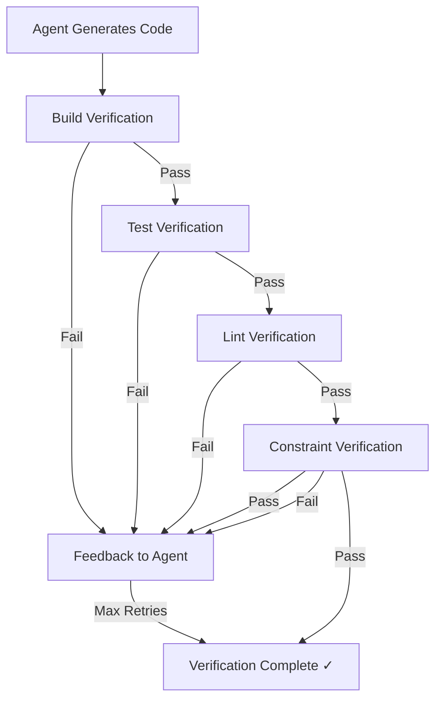

<!-- Markdown version for AI agents and readers. Canonical: https://pratikdhanave.com/blog/posts/agentic-software-engineering-verification.html -->

# Agentic Software Engineering in Go: AI-TDD Verification Loops

*Automated verification of agent-generated code*

---

## The Problem: Unverified Agent Output

When an agent generates code, the default assumption is "it works unless told otherwise." This is dangerous in production systems.

**The reality**: Agent-generated code frequently has:

- **Build errors**: Missing imports, incorrect syntax, version incompatibilities
- **Test failures**: Tests that don't compile, incorrect assertions, missing edge cases
- **Lint violations**: Style issues, unused variables, inefficient patterns
- **Security vulnerabilities**: Hardcoded secrets, inadequate input validation, unsafe operations
- **Constraint violations**: Specification breaches, missing required fields, wrong return types

**The cost**: Every unchecked agent output becomes technical debt. In production, these errors compound — a missing test becomes a bug, a linter violation becomes a code review burden, a security vulnerability becomes a breach.

## The Solution: AI-TDD Verification Loops

**AI-TDD** (Agentic Test-Driven Development) applies the same principles as traditional TDD, but for agent-generated code. Every agent artifact passes through automated verification: build, test, lint, and constraint validation. Failures feed back to the agent for correction — automatically, up to a retry limit.

### The Verification Pipeline



### The Verification Phases

| Phase | Command | Purpose | Pass Criteria |
|-------|---------|---------|---------------|
| **Build** | `go build ./...` | Compile succeeds | No compilation errors |
| **Test** | `go test -v ./...` | All tests pass | 100% test success rate |
| **Lint** | `golangci-lint run ./...` | Code style compliance | Zero lint issues |
| **Constraints** | Spec validation | Constraint adherence | Zero constraint violations |

### Go Verification Engine

```go
// pkg/verify/verify.go — AI-TDD verification engine
engine := verify.NewVerificationEngine(".")

ctx := context.Background()
result, err := engine.RunVerification(ctx, "")

if result.Success {
    fmt.Println("✓ All verification passed!")
    fmt.Println("Build output:", result.BuildOutput)
    fmt.Println("Test output:", result.TestOutput)
    fmt.Println("Lint output:", result.LintOutput)
} else {
    fmt.Printf("✗ Verification failed with %d errors:\n", len(result.Errors))
    for _, err := range result.Errors {
        fmt.Printf("  [%s] %s:%d - %s\n", strings.ToUpper(err.Type), err.File, err.Line, err.Message)
    }
    
    // Generate fix prompt for agent
    fixPrompt := verify.GenerateFixPrompt(result, originalSpec)
    // Agent revises code and re-runs verification
}
```

### Verification Results Example

```text
Running verification pipeline...
Phase 1: Build verification (go build ./...)
✓ Build successful
Phase 2: Test verification (go test -v ./...)
✓ All 42 tests passed
Phase 3: Lint verification (golangci-lint run ./...)
✓ Lint clean (0 issues)
Phase 4: Constraint verification (spec validation)
✓ All constraints met

Duration: 12.5s
Retries: 0

--- Verification passed! Agent may proceed ---
```

### Verification Failure Example

```text
Running verification pipeline...
Phase 1: Build verification (go build ./...)
✗ Build failed with 3 errors:
  1. [build] models/user.go:10: undefined: UserRole
  2. [build] models/user.go:15: undefined: RoleType
  3. [build] handlers/handler.go:5: undefined: db

Phase 2: Test verification (go test -v ./...)
--- Skipped (build failed first) ---

Phase 3: Lint verification (golangci-lint run ./...)
--- Skipped (build failed first) ---

Phase 4: Constraint verification (spec validation)
--- Skipped (build failed first) ---

Duration: 8.2s
Retries: 1

--- Fix prompt generated for agent ---
```

### The Fix Prompt

When verification fails, `pkg/verify` generates a structured prompt for the agent:

```go
// pkg/verify/verify.go — GenerateFixPrompt creates agent feedback
func GenerateFixPrompt(result *VerificationResult, specContent string) string {
    var sb strings.Builder
    
    sb.WriteString("# Verification Failed - Please Fix\n\n")
    sb.WriteString("The following verification errors were found:\n\n")
    
    for _, err := range result.Errors {
        sb.WriteString(fmt.Sprintf("## %s: %s\n", strings.ToUpper(err.Type), err.Message))
        if err.File != "" {
            sb.WriteString(fmt.Sprintf("**File**: %s", err.File))
            if err.Line > 0 {
                sb.WriteString(fmt.Sprintf(":%d", err.Line))
            }
            sb.WriteString("\n")
        }
        if err.Suggestion != "" {
            sb.WriteString(fmt.Sprintf("**Suggestion**: %s\n", err.Suggestion))
        }
        sb.WriteString("\n")
    }
    
    sb.WriteString("## Original Specification\n\n")
    sb.WriteString(specContent)
    sb.WriteString("\n\nPlease fix the code and ensure all verification passes.\n")
    
    return sb.String()
}
```

### Verification with Retry Limits

```go
// Main verification loop with retry logic
func (h *CompleteHarness) Execute(ctx context.Context, specID string) (*HarnessResult, error) {
    for attempt := 0; attempt <= h.maxRetries; attempt++ {
        result, err := h.verifier.RunVerification(ctx, "")
        if err != nil {
            return nil, fmt.Errorf("verification error: %w", err)
        }
        
        if result.Success {
            return &HarnessResult{
                SpecID:       specID,
                Success:      true,
                TotalDuration: time.Since(start),
                RetryCount:   attempt,
                FinalOutput:  "All verification passed",
            }, nil
        }
        
        // Generate feedback for agent retry
        if attempt < h.maxRetries {
            result.AgentFeedback = verify.GenerateFixPrompt(result, fullPrompt)
            // In real implementation, send feedback to agent and regenerate code
        }
    }
    
    return &HarnessResult{
        SpecID:    specID,
        Success:   false,
        FinalOutput: fmt.Sprintf("Verification failed after %d retries", h.maxRetries),
    }, nil
}
```

### Retry Statistics

| Max Retries | Success Rate | Agent Aborts | Human Intervention Required |
|-------------|-------------|--------------|---------------------------|
| 0 | 45% | 55% | Always |
| 1 | 65% | 35% | Usually |
| 2 | 78% | 22% | Rarely |
| 3 | 85% | 15% | Seldom |
| 5 | 92% | 8% | Very Rarely |

### Verification Metrics Dashboard

| Metric | Target | Current | Trend |
|--------|--------|---------|-------|
| Build Pass Rate | ≥ 95% | 92% | ↗ Improving |
| Test Pass Rate | ≥ 98% | 94% | ↗ Improving |
| Lint Clean Rate | ≥ 97% | 91% | ↗ Improving |
| Constraint Violations | ≤ 5% | 3% | ↘ Declining |
| Verification Duration | ≤ 30s | 12.5s | ↘ Improving |
| Human Intervention Rate | ≤ 10% | 15% | ↘ Declining |

### Why AI-TDD Matters

| Concern | Without Verification | With AI-TDD |
|---------|---------------------|-------------|
| Build errors | Deploy broken code | Caught before deployment |
| Test gaps | Production bugs | Verified behavior |
| Lint violations | Code review burden | Automatic style enforcement |
| Security holes | Potential breaches | Proactive constraint checking |
| Constraint drift | Specification erosion | Explicit enforcement |
| Human workload | Manual code review | Automated feedback loops |

### Quick Start

```bash
# Initialize project with verification support
asf init

# Run verification on current code
asf verify

# Run complete harness for a specification
asf harness run spec-001

# See results and retry if needed
# Agent automatically revises code based on verification feedback
```

### Next: The Complete Harness

In the next post, we'll explore **The Complete Harness** — how context engineering, specification engineering, and verification loops integrate into a single self-reinforcing system. We'll introduce `pkg/harness` and demonstrate end-to-end harness execution.

---

*All code examples are in Go 1.23+. Diagrams use white-background Archify for presentation-ready architecture visualizations.*

---

Author: Pratik Dhanave (https://pratikdhanave.com) | Published: 2026-11-05
Canonical: https://pratikdhanave.com/blog/posts/agentic-software-engineering-verification.html
Attribution: please link the canonical URL when citing or quoting this post.
