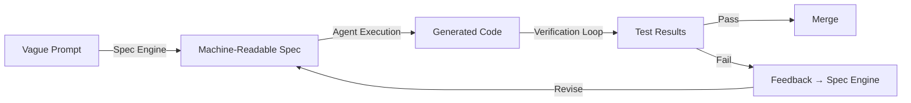

# Agentic Software Engineering in Go: Specification Engineering

*Replacing vague English prompts with precise, machine-readable specifications*

---

## The Problem: The English Prompt Trap

Most agentic workflows start with: *"Build a REST API for user management with authentication, validation, and error handling."*

**The problem**: This single sentence contains at least 7 ambiguities:
1. What format for authentication? JWT? Session? OAuth2?
2. What validation library? Go's native, validator, or custom?
3. What error format? HTTP status codes? Problem details?
4. Database schema? SQL? NoSQL? ORM?
5. API style? REST? gRPC? GraphQL?
6. Test coverage expectations?
7. Documentation requirements?

**The result**: Every agent produces different code. No two implementations are alike. Debugging becomes impossible. Handoffs between developers require re-reading and re-understanding the original intent.

## The Solution: Specification Engineering

**Specification Engineering** replaces ambiguous English prompts with precise, machine-readable specifications. A good specification defines:

1. **Intent** — What the agent should accomplish
2. **Constraints** — Hard boundaries the agent MUST follow
3. **Inputs** — Required and optional parameters
4. **Outputs** — Expected return values and formats
5. **Steps** — Executable plan the agent should follow
6. **Success Criteria** — How to verify correctness

### The Specification Lifecycle



### Go Specification Format (YAML)

```yaml
# specs/example.yaml
id: "spec-001"
version: "1.0"
title: "User CRUD API"
description: "Implement a complete user CRUD API with authentication"
intent:
  goal: "Implement user creation, retrieval, update, and deletion with JWT authentication"
  context: "Using PostgreSQL, JWT for auth, Go 1.23+"
  success_criteria:
    - "All CRUD operations work correctly"
    - "JWT tokens validate against secret key"
    - "Input validation rejects invalid data"
  anti_goals:
    - "No plain text password storage"
    - "No SQL injection vulnerabilities"
    - "No unrestricted API access"
constraints:
  - id: "c1"
    type: "must"
    description: "All passwords MUST be hashed with bcrypt"
    validator: "code to validate bcrypt usage"
  - id: "c2"
    type: "must_not"
    description: "API MUST reject requests without Authorization header"
    validator: "middleware validation"
inputs:
  user_creation:
    type: "object"
    description: "User creation payload"
    required: ["email", "password", "name"]
    properties:
      email:
        type: "string"
        format: "email"
        description: "User's email address"
      password:
        type: "string"
        minLength: 8
        description: "User's password"
      name:
        type: "string"
        description: "User's full name"
steps:
  - id: "s1"
    name: "Create User Repository"
    description: "Implement user repository with database operations"
    tool: "go build"
    depends_on: []
    validation: "Repository compiles and passes go vet"
  - id: "s2"
    name: "Implement Authentication Middleware"
    description: "Add JWT validation to all routes"
    tool: "go build"
    depends_on: ["s1"]
    validation: "Middleware returns 401 for invalid tokens"
  - id: "s3"
    name: "Create API Handlers"
    description: "Implement CRUD handlers for user resource"
    tool: "go build"
    depends_on: ["s2"]
    validation: "All handlers return correct HTTP status codes"
generated_prompt: |
  You are a Go agent tasked with implementing a user CRUD API.
  Follow the specification constraints above.
  Generate code step by step, validating each step before proceeding.
```

### Specification-Driven vs English-Prompt-Driven

| Aspect | English Prompt | Specification |
|--------|---------------|---------------|
| Ambiguity | High (multiple interpretations) | Low (explicit constraints) |
| Reproducibility | ❌ Different code each time | ✅ Same code every time |
| Testability | ❌ Hard to verify | ✅ Clear success criteria |
| Handoff | ❌ Requires re-reading | ✅ Exact specification transferred |
| Maintenance | ❌ Drifts over time | ✅ Version-controlled, explicit |
| Agent consistency | ❌ Variable output | ✅ Predictable output |

### Specification-Driven Workflow

```go
// pkg/spec/spec.go — Load and validate specifications
specEngine := spec.NewSpecEngine("specs/")

// Load all specifications
specs, _ := specEngine.LoadAllSpecs()
for id, s := range specs {
    // Validate spec completeness
    errors := specEngine.ValidateSpec(s)
    if len(errors) > 0 {
        fmt.Printf("Spec %s has errors: %v\n", id, errors)
    } else {
        fmt.Printf("Spec %s is valid ✓\n", id)
    }
    
    // Generate agent prompt
    prompt := specEngine.GeneratePrompt(s)
    fmt.Println("--- Agent Prompt ---")
    fmt.Println(prompt)
    fmt.Println()
}
```

### Code Generation from Spec

```go
// After specification is loaded and validated, the agent receives:
prompt := specEngine.GeneratePrompt(s)

// The agent then generates code step by step:
// 1. Repository layer (database operations)
// 2. Service layer (business logic)
// 3. Handler layer (HTTP endpoints)
// 4. Tests (verification)

// After each step, the verification engine checks:
result := verifier.RunVerification(ctx, "")
if result.Success {
    // Proceed to next step
} else {
    // Feed errors back to agent for revision
    fixPrompt := verify.GenerateFixPrompt(result, prompt)
    // Agent revises code
}
```

### Specification Versioning

Specifications, like code, evolve. The `spec` package supports:

```yaml
# Versioning in specs/factory.yaml
factory:
  version: "1.0"
  agents:
    - id: "gen-agent"
      model: "claude-sonnet-5"
  workflows:
    - id: "code-improvement"
      steps: [...]
```

When specifications change:
1. New version is tagged (e.g., `v1.1`)
2. Old versions are preserved for regression testing
3. Migration path is documented
4. Backward compatibility is verified

### Why Specification Engineering Matters

| Benefit | Impact |
|---------|--------|
| **Predictability** | Same spec → Same code every time |
| **Reproducibility** | Exact specification enables exact reproduction |
| **Handoff** | Specification is the single source of truth |
| **Maintenance** | Version-controlled, explicit constraints |
| **Agent Consistency** | Predictable output from same input |
| **Audit Trail** | Change history tracked via spec versions |

### Quick Start

```bash
# Initialize project with spec support
asf init

# Create a new specification
asf spec template specs/user-crud.yaml

# Edit the specification
# asf spec generate user-crud  # Generate agent prompt
# asf spec validate user-crud  # Validate the spec
# asf verify                    # Run verification

# The specification is now the single source of truth
# for all agent-generated code
```

### Next: AI-TDD Verification Loops

In the next post, we'll explore **AI-TDD Verification Loops** — how to automate build, test, lint, and constraint validation to prove agent-generated code is correct before merging. We'll introduce `pkg/verify` and demonstrate closed-loop feedback to the agent.

---

*All code examples are in Go 1.23+. Diagrams use white-background Archify for presentation-ready architecture visualizations.*