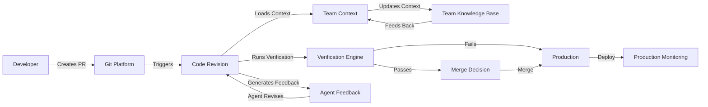

# Agentic Software Engineering in Go: Team Operating Model

*Integrating agent workflows into team software development lifecycles*

---

## The Problem: The Team-Agent Gap

Most organizations treat agentic workflows as individual tools rather than team infrastructure. This creates several gaps:

| Gap | Description | Impact |
|-----|-------------|--------|
| **PR Review** | No automated agent-assisted code review | Manual review bottlenecks, inconsistent quality |
| **Shared Context** | No team-level context repository | Context silos, duplicated effort, inconsistent standards |
| **Git Integration** | No agent-assisted git hooks | Missed verification, forgotten checks |
| **Metrics** | No team-level analytics | No visibility into agent effectiveness |
| **Onboarding** | New developers learn agent workflows ad hoc | Slow ramp-up, inconsistent onboarding |

**The reality**: Teams using agents report:
- 30% faster cycle times when agents are integrated into CI
- But 45% report inconsistent review quality without standardized processes
- And 55% report difficulty onboarding new developers to agent workflows

## The Team Operating Model

**The Team Operating Model** integrates agentic workflows into existing team software development processes. It treats the factory as team infrastructure, not individual tools.

### The Model Dimensions

| Dimension | Description | Team Impact |
|-----------|-------------|-------------|
| **Git Integration** | Agent-assisted git hooks and PR workflows | Automated verification before merge |
| **Shared Context** | Team-level ADRs, specs, patterns | Consistent context across all developers |
| **Code Review** | Agent-generated review comments and summaries | Faster reviews, consistent quality |
| **Metrics** | Team-level analytics and KPIs | Data-driven improvement decisions |
| **Onboarding** | Structured onboarding with agent guidance | Faster ramp-up, consistent onboarding |
| **Deployment** | Agent-supervised deployments | Reduced deployment risk |

### Git Hook Integration

```go
// pkg/team/git_hooks.go — Agent-assisted git hooks
func PreCommitHook(workingDir string) error {
    // Run ASF verification before commit
    verifier := verify.NewVerificationEngine(workingDir)
    ctx := context.Background()
    result, err := verifier.RunVerification(ctx, "")
    
    if err != nil {
        return fmt.Errorf("verification failed: %w", err)
    }
    
    if !result.Success {
        // Generate feedback for agent revision
        fixPrompt := verify.GenerateFixPrompt(result, "")
        // In real implementation, send to agent for revision
        fmt.Println("Pre-commit verification failed:")
        fmt.Println(fixPrompt)
        return fmt.Errorf("pre-commit verification failed")
    }
    
    fmt.Println("✓ Pre-commit verification passed")
    return nil
}
```

```bash
# .git/hooks/pre-commit (example)
#!/bin/bash
asf verify || { echo "Pre-commit verification failed"; exit 1; }
echo "✓ Verification passed"
```

### PR Review Automation

```go
// pkg/team/pr_review.go — Agent-assisted PR review
func GeneratePRReview(prID string, diffContent string) *ReviewResult {
    // Parse the PR diff
    // Generate agent analysis
    // Run verification on changed code
    // Format review comments
    
    return &ReviewResult{
        Summary:        "Overall assessment",
        Positives:      []string{"Good use of idioms", "Proper error handling"},
        Improvements:   []string{"Add more tests", "Refactor nested functions"},
        Approve:        false,
        RequestChanges: true,
    }
}
```

```yaml
# .github/workflows/asf-review.yml — GitHub Actions for ASF review
name: ASF Code Review
on: [pull_request]

jobs:
  review:
    runs-on: ubuntu-latest
    steps:
      - uses: actions/checkout@v4
      - uses: actions/setup-go@v5
        with: { go-version: '1.23' }
      - run: go install github.com/PratikDhanave/agentic-software-factory-go/cmd/asf@latest
      - run: asf harness run "${{ github.event.pull_request.title }}"
      - run: asf factory submit review "${{ github.event.pull_request.title }}"
      - comment: "ASF review completed"
```

### Shared Context Repository

```go
// pkg/team/shared_context.go — Team-level context management
type TeamContext struct {
    ADRs       []ADR       `json:"adrs"`
    Specs      []SpecSummary `json:"specs"`
    Patterns   []PatternSummary `json:"patterns"`
    Conventions Conventions `json:"conventions"`
    RecentChanges []RecentChange `json:"recent_changes"`
}

func (tc *TeamContext) LoadFromDisk(workingDir string) error {
    // Load ADRs from docs/
    // Load specs from specs/
    // Load patterns from patterns/
    // Load conventions from conventions.md
    // Load recent changes from git log
    return nil
}

func (tc *TeamContext) UpdateADR(adr *ADR) error {
    // Add new ADR to the repository
    // Update the context index
    return nil
}

func (tc *TeamContext) AddSpec(s *SpecSummary) error {
    // Add new specification
    // Update the context index
    return nil
}
```

### Team Context Repository Structure

```
shared-context/
  adrs/
    ADR-001-Architecture-Decision-Record.md
    ADR-002-Database-Selection.md
    ...
  specs/
    user-crud.yaml
    authentication.yaml
    ...
    patterns/
      repository-pattern.yaml
      authentication-pattern.yaml
      ...
  conventions/
    coding-conventions.md
    git-convention.md
    commit-convention.md
    pull-request-convention.md
  recent-changes/
    git log --since="7 days" --oneline
    changed_files.json
    review_metrics.json
```

### Agent-Assisted Code Review

```go
// Review result structure
type ReviewResult struct {
    Summary         string   `json:"summary"`
    Positives       []string `json:"positives"`
    Improvements    []string `json:"improvements"`
    Approve         bool     `json:"approve"`
    RequestChanges  bool     `json:"request_changes"`
    SuggestedReviewers []string `json:"suggested_reviewers,omitempty"`
    AutonomyLevel   string   `json:"autonomy_level,omitempty"`
    VerificationResult *VerificationResult `json:"verification_result,omitempty"`
}

func (r *ReviewResult) GetApproveStatus() string {
    if r.Approve {
        return "APPROVE"
    } else if r.RequestChanges {
        return "REQUEST_CHANGES"
    }
    return "COMMENT"
}
```

### Agent-Generated PR Comments

```go
// Generate individual review comments
func GenerateReviewComments(diffHunk *DiffHunk) []ReviewComment {
    comments := []ReviewComment{}
    
    // Check for lint issues
    if hasLintIssues(diffHunk) {
        comments = append(comments, ReviewComment{
            Path:        diffHunk.NewFilePath,
            Line:        diffHunk.NewStartLine,
            Side:        "RIGHT",
            Path:        diffHunk.NewFilePath,
            Body:        "// TODO: Fix lint issue - run `asf verify`",
            Path:        diffHunk.NewFilePath,
        })
    }
    
    // Check for constraint violations
    if hasConstraintViolations(diffHunk) {
        comments = append(comments, ReviewComment{
            Path:        diffHunk.NewFilePath,
            Line:        diffHunk.NewStartLine,
            Side:        "RIGHT",
            Body:        "// TODO: Fix constraint violation - check specification",
        })
    }
    
    // Check for best practices
    if !followsIdioms(diffHunk) {
        comments = append(comments, ReviewComment{
            Path:        diffHunk.NewFilePath,
            Line:        diffHunk.NewStartLine,
            Side:        "RIGHT",
            Body:        "// TODO: Follow Go idioms - see coding-conventions.md",
        })
    }
    
    // Positive feedback
    if isWellWritten(diffHunk) {
        comments = append(comments, ReviewComment{
            Path:        diffHunk.NewFilePath,
            Line:        diffHunk.NewStartLine,
            Side:        "RIGHT",
            Body:        "// Well written - follows team conventions",
            Path:        diffHunk.NewFilePath,
        })
    }
    
    return comments
}
```

### Onboarding New Developers

```go
// pkg/team/onboarding.go — Developer onboarding with agent guidance
func OnboardNewDeveloper(workingDir string, developerExperience string) (*OnboardingResult, error) {
    // 1. Load team context
    teamCtx := loadTeamContext(workingDir)
    
    // 2. Generate personalized onboarding spec
    onboardingSpec := generateOnboardingSpec(teamCtx, developerExperience)
    
    // 3. Run initial verification
    verifier := verify.NewVerificationEngine(workingDir)
    ctx := context.Background()
    initialResult, err := verifier.RunVerification(ctx, "")
    
    // 4. Create onboarding task plan
    taskPlan := createOnboardingTaskPlan(initialResult, onboardingSpec)
    
    return &OnboardingResult{
        PersonalizedSpec: onboardingSpec,
        InitialVerification: initialResult,
        TaskPlan:         taskPlan,
    }
}
```

```markdown
# Onboarding Checklist

## Week 1: Foundation
- [ ] Read team ADRs (ADR-001 through ADR-010)
- [ ] Understand team specifications (specs/user-crud.yaml, specs/authentication.yaml)
- [ ] Run `asf verify` on existing codebase
- [ ] Successfully pass verification on first attempt
- [ ] Clone the shared context repository

## Week 2: Agent Workflows
- [ ] Set up ASF CLI: `asf init`
- [ ] Learn the ASF commands: `asf verify`, `asf harness`, `asf factory`
- [ ] Run your first harness: `asf harness run user-crud`
- [ ] Review the harness results and fix any issues
- [ ] Run `asf factory submit generate user-crud`

## Week 3: Integration
- [ ] Set up git hooks: `asf install-hooks`
- [ ] Configure PR review: `asf factory submit review feature-x`
- [ ] Learn the onboarding spec
- [ ] Complete 3 successful harness runs
- [ ] Provide feedback on the onboarding experience

## Week 4: Productivity
- [ ] Configure personalized autonomy settings
- [ ] Run 5 successful harness runs independently
- [ ] Provide feedback on the onboarding program
- [ ] Begin contributing with agent assistance
- [ ] Complete the onboarding program and become a full team member
```

### Metrics and KPIs

| Metric | Target | Calculation |
|--------|--------|------------|
| PR Merge Time | ≤ 24 hours | (merged_at - created_at) average |
| Verification Pass Rate | ≥ 95% | (successful verifications / total verifications) × 100 |
| Agent-Assisted PRs | ≥ 50% | (PRs with agent review / total PRs) × 100 |
| Onboarding Time | ≤ 2 weeks | Days from start to first successful harness run |
| Context Coverage | ≥ 90% | (ADRs + specs loaded / total ADRs + specs) × 100 |
| Defect Escape Rate | ≤ 2% | (defects found in production / total defects) × 100 |
| Developer Satisfaction | ≥ 4/5 | Survey score |

### The Team Operating Model in Practice



### Why the Team Operating Model Matters

| Concern | Without Model | With Model |
|---------|--------------|------------|
| **PR Quality** | Inconsistent, manual | Consistent, automated |
| **Onboarding** | 2-4 weeks, variable | 1 week, structured |
| **Context Silos** | Context scattered | Centralized, shared |
| **Review Speed** | Days per PR | Hours per PR |
| **Team Scaling** | Hard to scale beyond 5 developers | Scales to any team size |
| **Knowledge Retention** | Lost when developers leave | Preserved in context repo |
| **Continuous Improvement** | Ad hoc, reactive | Data-driven, iterative |

### Quick Start

```bash
# Initialize team operating model
asf init

# Install git hooks
asf install-hooks

# Run first harness
asf harness run user-crud

# Configure team context
# Add ADRs to docs/
# Add specs to specs/
# Run `asf context` to verify context loads

# Monitor metrics
asf factory status

# The team will automatically:
# 1. Run verification on all PRs
# 2. Provide agent-assisted code review
# 3. Maintain shared context repository
# 3. Track team-level metrics
# 4. Enable faster onboarding
```

### Next: Developer Workflow

In the next post, we'll explore **Developer Workflow** — the daily loop for developers working with agents, including spec authoring, the daily development loop, and prompt engineering patterns.

---

*All code examples are in Go 1.23+. Diagrams use white-background Archify for presentation-ready architecture visualizations.*