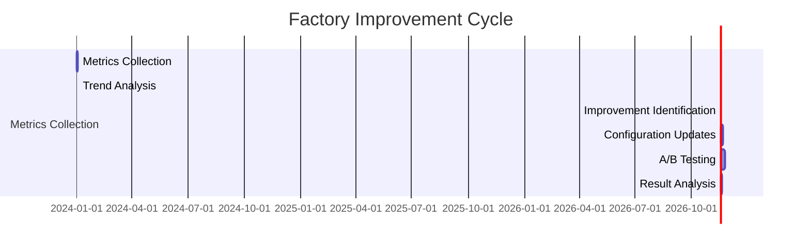

# Agentic Software Engineering in Go: Production Operations & Metrics

*Observability, continuous improvement, and scaling beyond the individual*

---

## The Problem: The "Black Box" Factory

Most agentic factories are **black boxes**:

- You submit a task, but you don't know what happens inside
- No visibility into agent behavior or decision-making
- No metrics on performance, quality, or cost
- No way to improve the system over time
- "Works on my machine" becomes the de facto deployment standard

**The problem**: Without observability and continuous improvement, factories degrade over time:

- **Quality drift**: Agent output quality slowly declines as context becomes stale
- **Cost creep**: Unoptimized models and inefficient prompts increase costs
- **Security drift**: Prompt injection techniques evolve, bypassing old defenses
- **Stagnation**: No feedback loop means no learning from mistakes
- **Blind spots**: Team has no data to make informed decisions about agent usage

## The Observability Stack

**The Observability Stack** provides full visibility into factory operations.

### 1. Metrics Pipeline

```go
// pkg/metrics/metrics.go — Factory metrics collection
type FactoryMetrics struct {
    // Task metrics
    TasksSubmitted    int64
    TasksCompleted    int64
    TasksFailed       int64
    AverageDuration   float64
    TasksByType       map[string]int64
    
    // Verification metrics
    VerificationPassRate float64
    AverageVerificationDuration float64
    VerificationErrorsByType map[string]int64
    
    // Agent metrics
    ActiveWorkers     int
    AverageAutonomyLevel string
    AutonomyScoreDistribution map[string]int64
    
    // Security metrics
    PromptInjectionsBlocked int64
    SecurityViolations      int64
    RBACViolations          int64
    
    // Timestamp
    Timestamp time.Time
}
```

```go
// Metrics collection example
func RecordTaskSubmitted(taskType string) {
    metrics.TaskSubmitted++
    metrics.TasksByType[taskType]++
}

func RecordVerificationResult(success bool, duration time.Duration) {
    if success {
        metrics.VerificationPassRate = (metrics.VerificationPassRate*float64(metrics.VerificationSubmitted-1) + 1) / float64(metrics.VerificationSubmitted+1)
    } else {
        metrics.VerificationErrorsByType[getErrorType()]++
    }
    metrics.AverageVerificationDuration = (metrics.AverageVerificationDuration*float64(metrics.VerificationSubmitted) + duration.Seconds()) / float64(metrics.VerificationSubmitted+1)
    metrics.VerificationSubmitted++
}
```

### 2. Log Correlation

```go
// Structured logging with correlation IDs
type LogEntry struct {
    CorrelationID string      `json:"correlation_id"`
    TraceID       string      `json:"trace_id"`
    Timestamp     time.Time   `json:"timestamp"`
    Level         string      `json:"level"`
    Component     string      `json:"component"`
    Action        string      `json:"action"`
    Success       bool        `json:"success"`
    Metadata      map[string]string `json:"metadata"`
}

func LogAgentAction(correlationID, component, action string, success bool, metadata map[string]string) {
    entry := LogEntry{
        CorrelationID: correlationID,
        Component:    component,
        Action:       action,
        Success:      success,
        Metadata:     metadata,
        Timestamp:    time.Now(),
    }
    structuredLog(entry)
}
```

### 3. Tracing

```go
# OpenTelemetry tracing integration
func (fo *FactoryOrchestrator) startTracing(ctx context.Context) {
    tp := trace.NewTracerProvider(
        trace.WithBatcher(func(spans []trace.Span) error {
            exportSpans(spans)
        }),
    )
    traceProvider = tp
    
    # Create spans for factory operations
    ctx, span := trace.SpanFromContext(ctx, "factory_start")
    # ... record span events
    span.End()
}
```

### 4. Dashboards

```go
# Factory metrics dashboard endpoint
func (fo *FactoryOrchestrator) GetMetrics() factory.Metrics {
    fo.mu.RLock()
    defer fo.mu.RUnlock()
    
    return factory.Metrics{
        WorkersTotal:         fo.workerCount,
        WorkersBusy:          busyCount,
        TasksPending:         len(fo.taskQueue),
        TasksCompleted:      completedCount,
        TasksFailed:          failedCount,
        VerificationPassRate: verificationPassRate,
        AverageDuration:      averageDuration,
    }
}
```

### Observability Dashboard

```mermaid
dashboard
    title "Agentic Software Factory Observability"
    
    grid "Tasks" {
        stat "Tasks Submitted/hr" metrics.TasksSubmitted/3600 "green"
        stat "Tasks Completed/hr" metrics.TasksCompleted/3600 "yellow"
        stat "Tasks Failed/hr" metrics.TasksFailed/3600 "red"
    }
    
    grid "Verification" {
        stat "Pass Rate" metrics.VerificationPassRate "green"
        stat "Avg Duration" fmt.Sprintf("%.1fs", metrics.AverageVerificationDuration) "yellow"
    }
    
    grid "Factory" {
        stat "Active Workers" metrics.ActiveWorkers "yellow"
        stat "Autonomy Level" metrics.AutonomyLevel "yellow"
    }
    
    grid "Security" {
        stat "Prompt Injections Blocked" metrics.PromptInjectionsBlocked "green"
        stat "Security Violations" metrics.SecurityViolations "red"
    }
```

### Continuous Improvement Pipeline

```mermaid
flowchart TD
    A[Collect Metrics] --> B[Analyze Trends]
    B --> C[Identify Improvements]
    C --> D[Update Configurations]
    D -->[E Deploy]
    E -->|A/B Test| F[Measure Impact]
    F -->|Improve| A
    G[Regress] -->|Rollback| A
```

### Improvement Loop

```go
# Improvement pipeline
func (fo *FactoryOrchestrator) RunImprovementCycle() error {
    # 1. Collect metrics from last cycle
    metrics := fo.CollectMetrics()
    
    # 2. Analyze trends
    trends := fo.AnalyzeTrends(metrics)
    
    # 3. Identify improvement opportunities
    improvements := fo.IdentifyImprovements(trends)
    
    # 4. Apply configurations
    for _, improvement := range improvements {
        if err := fo.ApplyConfiguration(improvement); err != nil {
            return err
        }
    }
    
    # 5. A/B test if needed
    if len(improvements) > 1 {
        results := fo.RunABTest(improvements)
        if !results[0].BetterThan(results[1]) {
            # Revert the worse improvement
            fo.RevertConfiguration(improvements[1])
        }
    }
    
    return nil
}
```

### A/B Testing Factory Configurations

```go
# A/B test two factory configurations
func (fo *FactoryOrchestrator) A/BTest(configA, configB string, duration time.Duration) (bool, error) {
    # 1. Apply config A
    err := fo.ApplyConfiguration(configA)
    if err != nil {
        return false, err
    }
    
    # Record metrics during A
    metricsA := fo.RecordMetrics(duration)
    
    # Apply config B
    err = fo.ApplyConfiguration(configB)
    if err != nil {
        return false, err
    }
    
    # Record metrics during B
    metricsB := fo.RecordMetrics(duration)
    
    # Compare results
    return metricsB.BetterThan(metricsA), nil
}
```

### Improvement Categories

| Category | Description | Example Improvements |
|------------|-------------|---------------------|
| **Model Routing** | Switch models based on task type | Use haiku for simple tasks, sonnet for complex |
| **Prompt Optimization** | Refine prompts based on failure patterns | Add missing constraints, clarify success criteria |
| **Autonomy Calibration** | Adjust autonomy based on success/failure | Raise/lower autonomy thresholds |
| **Context Updates** | Add missing ADRs/specs based on gaps | Add new ADRs for frequently failed areas |
| **Scheduler Tuning** | Optimize worker pool size and timing | Adjust pool size, timeout values |
| **Security Rules** | Update prompt injection patterns | Add new blocked patterns, refine RBAC |

### Improvement Dashboard



### Quick Start

```bash
# Initialize with observability
asf init --with-observability

# Start factory with metrics
asf factory start

# Access metrics at http://localhost:8080/metrics

# Run improvement cycle
asf factory improve

# View dashboard at http://localhost:8080/dashboard

# The factory will automatically:
# 1. Collect metrics on every operation
# 2. Analyze trends and identify improvements
# 3. Apply configuration updates
# 4. Run A/B tests to validate improvements
# 5. Provide dashboard for monitoring
```

### Why Observability Matters

| Concern | Without Observability | With Observability |
|---------|----------------------|---------------------|
| **Quality Tracking** | "It seems to work" | Data-driven quality metrics |
| **Cost Optimization** | Unknown costs | Model routing, prompt optimization |
| **Security Posture** | Unknown vulnerabilities | Tracked violations and block rates |
| **Team Decisions** | Anecdotal, subjective | Data-driven improvements |
| **Scaling Decisions** | Guesswork | Metrics-based scaling |
| **Incident Response** | Blind to issues | Immediate visibility |
| **Continuous Improvement** | Ad hoc, reactive | Systematic, iterative |

### Quick Start

```bash
# Initialize with observability
asf init --with-observability

# Start factory with metrics endpoint
asf factory start

# Access metrics at http://localhost:8080/metrics
# Access dashboard at http://localhost:8080/dashboard

# Run improvement cycle
asf factory improve

# View trend analysis and apply recommended configurations
```

### Next: Case Study

In the next post, we'll present a **case study** of an end-to-end implementation: taking a feature from specification through to production deployment.

---

*All code examples are in Go 1.23+. Diagrams use white-background Archify for presentation-ready architecture visualizations.*